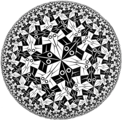

# WHACK26 – DEBBelobers

## 📖 Brief

This is the project that we built as a team for the 2026 Warwick Hackathon, wherein over 400 students took to one of four coding briefs set by real software companies, and built a working solution over a 24-hour period.

**Our Brief Was:**
*Build something that opens a door to the unexplored, whether that's new data, new ideas, or something novel that no one has seen before.*

## 💡 Plan

We plan to create a piece of software that simulates the same world across multiple different dimensions, which the user can switch between. This gives the user a **novel** experience of an otherwise ordinary world.

Our project is heavily inspired by the artwork of **M. C. Escher**, particularly his depictions of impossible geometry and alternative spatial representations.

For example, the Poincaré Disc:

### 🚀 Minimum Viable Product (MVP)

Our MVP will consist of a simple simulation featuring Blender-crafted assets, with the ability to toggle between 2D and 3D representations of a simple world.

A first-person user will be able to navigate the world and explore how the different modes affect their perspective.

The MVP will also hopefully include one further dimension or spatial representation, allowing us to bring our original idea to life more effectively.

### 🌌 Future Extensions

We hope to significantly extend the MVP by introducing hyperbolic 3D, 4D, and other non-Euclidean representations of space.

We also plan to add more assets to create a richer and more immersive experience.

If time allows, we might explore representing other forms of dimensional space to make the final result even more impressive.

## 🏆 Overnight Achievements (For Ethan)

- We have working shaders and both 2D and 3D representations.
- The map has increased in size and quality.
- Ben learned all about Git (in every interpretation).
- The game now loads into 3D rather than 2D.
- Development of hyperbolic mode has begun!

## 🛠️ Libraries, Engines & Software

- **[raylib](https://www.raylib.com/)** – Our main graphical engine, heavily built around the raylib library.
  - GitHub: https://github.com/raysan5/raylib
- **[rlgl](https://github.com/raysan5/raylib/blob/master/src/rlgl.h)** – Our hyperbolic mode makes use of this related, lower-level raylib library.
- **[Blender](https://www.blender.org/)** – Used to create the assets for the project.
- **[Visual Studio Code](https://code.visualstudio.com/)** – Used for all code development.

## 👥 The Team

**Define Legendary**  

- **Thesupernile** – https://github.com/Thesupernile
- **MasterUgwae** – https://github.com/MasterUgwae
- **ethanhawksley** – https://github.com/ethanhawksley
- **BWatters53**

*(Reverse alphabetical order, because why not.)*
